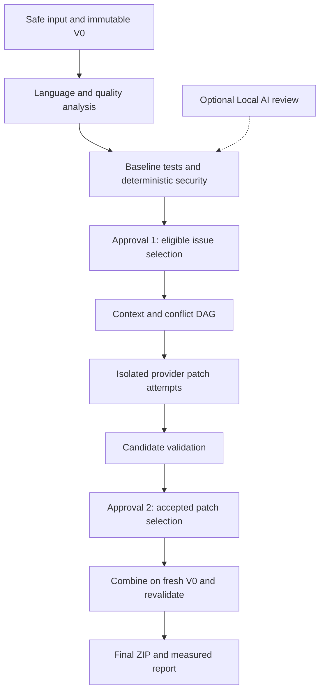

# Architecture and safety contracts

> **Governance (separate from runtime architecture):** Follow the [GitHub development workflow](governance/PROJECT_GENESIS_CODEX_NATIVE_PROTOCOL_V3.md) for repository work. The approved SRS and this architecture govern product behavior.

This is the intended architecture, not a list of delivered capabilities. Sources: master system architecture, step-by-step development guide and approved five-person work-package plan. The course deadline and account confirmations supersede the older relative 12-week schedule. Private source PDFs/DOCX are not republished.

| Component | Responsible runtime module | Contract/output |
|---|---|---|
| FastAPI orchestrator, state/queue, storage | Core API and workers | Runs, consent, immutable versions, idempotent jobs |
| Language Router and adapters | Language adapters | Per-component language capabilities, symbols, source locations, uncertainty |
| Quality and deterministic security tools | Quality/SAST workers | Normalized findings with real evidence and stable rule/tool versions |
| Mandatory first-delivery Qwen3-Coder 30B-A3B local review | Isolated Local AI service | Evidence-labelled review, bounded inference, explicit fallback |
| Context builder, conflict DAG, providers | Context/patch orchestration | Bounded masked context, isolated patch attempts, conservative scheduling |
| Sandbox, candidate and final validation | Validation workers | Frozen tests, regression/security results, independent behavior/quality outcomes |
| React/TypeScript/Monaco and reporting | User interface and reporting service | Two approvals, diff, evidence-linked measurements/history |

The two approvals are product decisions; an independent GitHub PR review is a separate development control. A model's security claim is unconfirmed until supported by tool/test/independent evidence. Security findings do not silently become eligible quality-refactoring tasks.

V0 and frozen test hashes must remain unchanged. Patches cannot edit tests or weaken rules; candidate workspaces and final combination are distinct. At most one initial patch plus two correction attempts; provider network retries are a separate budget. Unknown symbol/side-effect relationships serialize conservatively. Max parallelism is bounded, with planned acceptance of six genuinely independent tasks ([ADR 0007](DECISIONS/0007-local-llm-and-approval-authority.md); previously three).

`behavior_status` (PASSED/FAILED/UNVERIFIED) is independent from quality outcome. Build success alone does not establish behavior preservation. Individually passing patches still require a full combined build/regression/static/security validation. Failed attempts remain in denominators; zero denominators display N/A.

P0 first delivery includes Java 21/Maven/JavaParser/PMD/CPD, Python AST/LibCST and pytest/coverage.py, TypeScript API/ts-morph with ESLint and Jest/Vitest, deterministic security plus real Qwen3-Coder 30B-A3B local review, HTML/PDF/history. Implementation is dependency ordered, with Java pilot first, but all are required for first delivery. Capabilities and coverage remain per language/component; unresolved cross-service contracts remain uncertain.

Real local Qwen3-Coder 30B-A3B security review is **mandatory P0** ([ADR 0007](DECISIONS/0007-local-llm-and-approval-authority.md), replacing Qwen3-Coder 30B-A3B). Only this AST/SAST-paired review model runs locally; refactoring/patch LLMs run with authorized cloud providers on masked, bounded context packages. Its exact model revision, quantization, runtime, memory and latency must be measured in #19 on the target hardware (NVIDIA DGX Spark or ASUS Ascent GX10, GB10 with 128 GB; fallback: a 16 GB GPU served by llama.cpp). ARM64 compatibility of the language toolchains must be verified before purchase. M3 does not supply CUDA. Hardware and cloud API budget are requested but not yet approved; a missing GPU remains a release blocker, not a reason to drop scope.

## Development governance boundary (approved 2026-10-26)

The component labels above are *technical runtime responsibilities*, not permanent personal assignments. Project Genesis operates a single implementation owner: Burkay → Cafer → Alperen Enes Yaman → İsmail → Taha Uğur Toyran → repeat. Handoffs require verified publication and acceptance. [TR SRS](SRS.md) and [EN SRS](SRS_EN.md) v0.4.0 were APPROVED on 2026-10-27. PR #38 is merged pre-Genesis bootstrap and consumed no rotation turn.

## Developer rotation is distinct from module expertise

2026-10-26 owner decision: Burkay → Cafer → Alperen Enes Yaman → İsmail → Taha Uğur Toyran → Burkay. Expertise does not preassign ownership; the orchestrator chooses a ready task from verified prerequisites. PR #38/#39 were merged after the relevant approvals and checks; their historical review instructions are not current open-PR blockers.

## Seven mandatory language adapters — approved 2026-10-27

The first-delivery language set is **Java, Python, JavaScript, TypeScript, C#, Go and C++**, all P0, together with real local Qwen3-Coder 30B-A3B. Previous `future C#/Go/C++` statements are superseded. The existing LanguageAdapter/CIR, immutable V0, evidence registry, isolated runtime and patch/combined-validation boundaries remain unchanged; do **not** introduce a parallel refactoring pipeline.

- C# F14-CS (#40): Roslyn/.NET SDK for AST, symbol/dependency references and source ranges; real xUnit/NUnit/MSTest or compatible tests and coverage; isolated build/patch verification.
- Go F14-GO (#41): go/parser/go/types, modules/workspaces, go test/coverage, appropriate static rules and safe source patch evidence.
- C++ F14-CPP (#42): Clang AST/clang-tidy, real compilation database and compiler flags, native build/test/coverage in restricted sandbox; absent headers/compile context must yield UNVERIFIED.

The 34-task / 69-dependency GitHub-native graph was subsequently verified; the original 31 tasks / 54 edges were preserved. Required F14-MIX (#34) and F15-P0 (#35) join gates remain subject to actual accepted prerequisites. No approval, CI check or historical transition is equivalent to product implementation. PR #38 approval and review are historical, not outstanding.

## Mandatory seven-language first-delivery architecture — 2026-10-27

Owner-approved P0: Java, Python, JavaScript, TypeScript, C# (Roslyn/.NET), Go (module-aware parser/types) and C++ (Clang/compilation database) are **all required working adapters**, together with real Qwen3-Coder 30B-A3B, two user approval gates, isolated original/frozen-test patch validation and HTML/PDF/ZIP/history. Older language-extension text is superseded by this decision.

F14-CS (#40), F14-GO (#41) and F14-CPP (#42) depend on F02-CONTRACT, F06-SANDBOX and F11-VALIDATE. Each requires real parse/symbol/quality/build/test/coverage and safe-patch evidence, including failure/regression cases; missing toolchains remain UNVERIFIED. F14-MIX (#34) joins the language adapters; F15-P0 (#35) requires F14-MIX, F07B-LOCAL and F13-ADV. Use live accepted prerequisites rather than the older PENDING_SAFE_SYNC narrative. See [SRS TR](SRS.md) and [SRS EN](SRS_EN.md).
